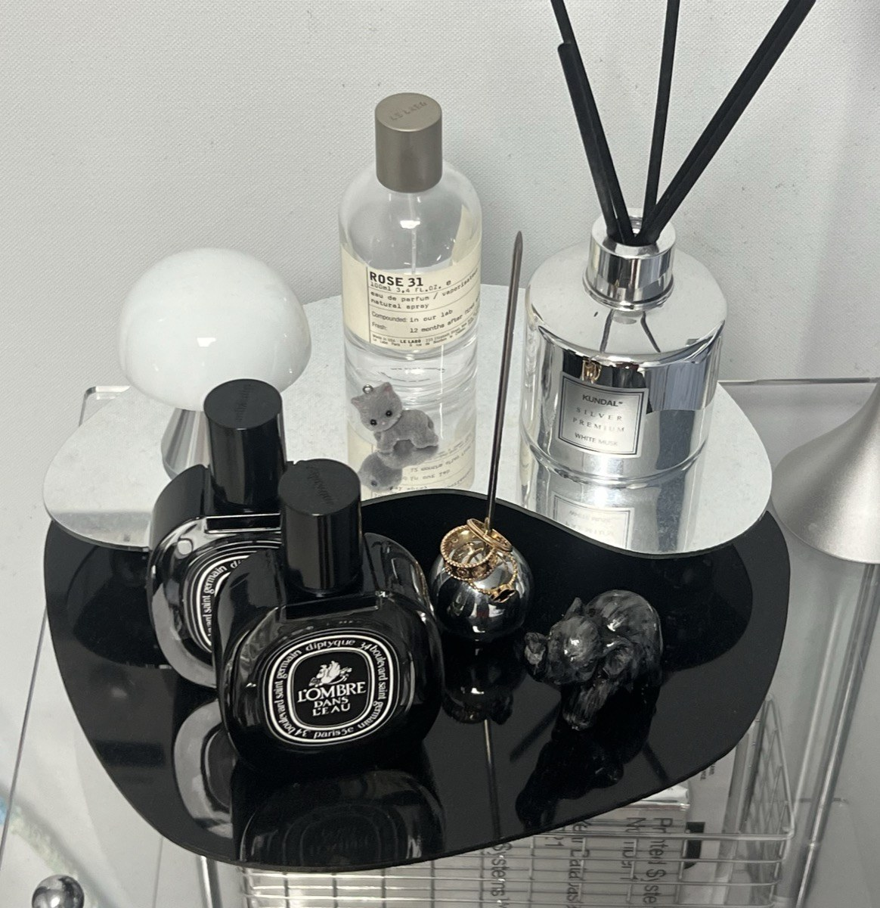
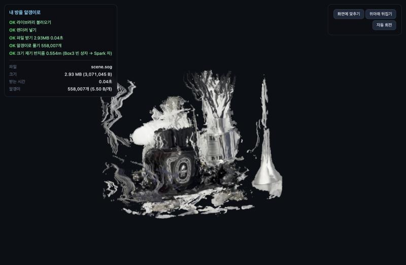
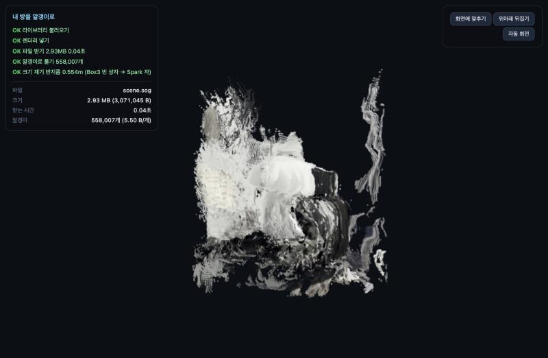

# 선반 위 소품을 알갱이로 — 03-07 실습

폰으로 찍은 15초 영상 하나에서 3차원 장면을 만들고, 가우시안 스플랫으로 바꿔 브라우저에서 돌려 보는 실습 결과입니다.
복원부터 뷰어까지 코딩 에이전트 **OpenCode**(room-3d 스킬)로 진행했습니다.

## 어떤 물건을 돌렸나



침대 옆 투명 아크릴 선반 맨 위의 소품 모음입니다.

- 검은 쟁반 위: 검은 향수병 2개, 반지를 끼운 은색 공 모양 반지 꽂이, 검은 코끼리 소품
- 거울 쟁반 위: 투명 향수병과 회색 고양이 피규어, 은색 디퓨저와 검은 스틱, 흰 버섯 모양 무드등
- 오른쪽: 은색 원뿔 램프

## 공개 판단

배경이 개인 방(침대, 베개, 벽)이라서 **벽·침대·베개·금속 기둥을 점 단계에서 지우고 소품만 남겼습니다.**
소품 사진은 위치 정보(GPS)를 지운 사본입니다. 화면에 얼굴, 이름, 주소 같은 개인정보는 없습니다.

## 촬영

| 항목 | 값 |
|---|---|
| 촬영한 부분 | 선반 맨 위 소품 (정면에서 오른쪽 비스듬한 방향까지) |
| 걸은 경로 | 소품을 화면 가운데에 두고 왼쪽 → 오른쪽으로 원호를 따라 옆걸음 (소품까지 약 0.5~0.9m) |
| 영상 | 1920×1080 가로, 14.9초, 30fps |
| 추출한 프레임 | 24장, 960×540으로 줄임 |

## 복원 (실습 1)

| 항목 | 값 |
|---|---|
| 모델 | `facebook/map-anything-apache`, fp16 |
| GPU | 코랩 Tesla T4 (15.6GB) |
| 복원 시간 | 10.7초 |
| 최대 GPU 메모리 | 6.7GB |
| 점 개수 | 2,887,086 → 튄 점 제거 후 2,832,878 |
| 카메라 퍼짐 비 | **0.238** (카메라 상자 대각선 0.917m ÷ 장면 대각선 3.848m) |

카메라 배치 그림에서 카메라 24대가 실제로 걸은 원호 모양 그대로 놓였고, 모두 소품 쪽을 바라봤습니다. 퍼짐 비도 기준(0.1)보다 커서 제자리 회전이 아니라 옆으로 이동하며 찍은 것이 확인됐습니다.

## 배경 걸러 내기 (교안 외 추가 단계)

| 방법 | 내용 |
|---|---|
| 벽 평면 | RANSAC으로 벽 평면을 찾아 그 뒤쪽 점 제거 |
| 카메라 거리 | 점을 만든 카메라에서 0.9m 넘게 떨어진 점 제거 (침대·벽은 0.9m 이상, 소품은 0.4~0.7m) |
| 자르기 상자 | x −0.10~0.60, y −0.50~0.16, z 0.33~0.90 (m) |
| 덩어리 | 소품 덩어리와 원뿔 램프 덩어리만 남기고 1,000점 미만 부스러기 제거 |
| 결과 | **558,007점** 남김 (원래의 19.7%), 가장 긴 변 0.70m |

## 알갱이로 바꾸고 줄이기 (실습 2·3)

알갱이 반지름 = K × 장면의 가장 긴 변 ÷ √N = 1.4 × 0.700 ÷ √558,007 ≈ **1.3mm**

| 형식 | 파일 크기 | 알갱이 개수 | 알갱이당 바이트 | 시간 |
|---|---|---|---|---|
| `.ply` (INRIA, `f_rest` 없음) | 37,944,892 B (36.2 MiB) | 558,007 | 68.0 | 저장 0.04초 |
| `.sog` (splat-transform 3.10.3) | 3,071,045 B (2.93 MiB) | 558,007 | 5.5 | 변환 2.1초 |

SOG로 바꿔 파일이 92% 줄었지만 알갱이 개수는 그대로입니다. 받는 양만 줄었고 그릴 알갱이 수는 같습니다.

## 뷰어

three.js 0.180.0 + Spark 2.4.0, 빌드 없이 `index.html` 하나로 엽니다. 회전·확대·이동, 위아래 뒤집기, 진행 상태 5단계와 파일 크기·받는 시간·알갱이 수를 표시합니다.



로컬(같은 컴퓨터)에서 `scene.sog` 2.93MB를 받는 데 0.04초 걸렸습니다. 폰과 다른 기기에서 첫 화면까지 걸린 시간은 아직 재지 않았습니다.

## 잘 보이는 방향과 무너지는 방향

**잘 보이는 방향:** 촬영한 원호 쪽(정면에서 오른쪽 비스듬히)입니다. 향수병 라벨, 디퓨저 스틱, 원뿔 램프, 쟁반을 알아볼 수 있습니다. 같은 부분이 여러 사진에 이어서 찍혀 시차로 깊이를 구할 수 있었습니다.



**무너지는 방향:** 옆면과 뒷면입니다. 원본 영상을 보면 카메라가 앞쪽 원호로만 움직였기 때문에, 이 면은 어떤 사진에도 찍히지 않았습니다. 점 자체가 없으니 알갱이 크기(K)를 키워도 채워지지 않고, 다시 찍어야 합니다.

**줄무늬처럼 늘어진 자국:** MapAnything이 사진마다 깊이를 따로 추정한 뒤 겹쳐 놓기 때문에, 사진끼리 깊이가 조금씩 어긋나면 같은 표면이 여러 겹으로 쌓입니다. 정면에서는 겹쳐 보여 티가 덜 나지만, 옆에서 보면 길게 늘어져 보입니다.

**듬성듬성한 물건:** 투명 향수병과 흰 버섯 무드등은 점이 적습니다. 투명하거나 무늬 없이 하얀 표면은 사진 사이에서 같은 부분을 찾기 어렵기 때문입니다. 거울 쟁반도 보는 방향에 따라 비친 모습이 달라져 복원이 어렵습니다.

**남은 벽 조각:** 디퓨저 뒤쪽에 흰 벽 조각이 조금 남았습니다. 소품과 가까운 벽이라 카메라 거리 기준에 걸리지 않았습니다.

## 다음에 바꿀 것

- 대상 둘레를 반 바퀴 이상 돌고, 높이를 바꿔 한 번 더 찍기 → 옆면·윗면 채우기
- 거울 쟁반처럼 반사가 심한 물건은 빼거나 천으로 덮고 찍기
- 평가용 사진을 몇 장 따로 빼 두고 PSNR·SSIM·LPIPS로 비교하기

## 파일

```
site/
├── index.html        뷰어
├── scene.sog         줄인 알갱이 파일 (558,007개)
├── README.md         이 문서
└── shots/
    ├── object.jpg    촬영한 소품 사진 (위치 정보 제거)
    ├── viewer.png    뷰어 화면 — 촬영한 방향
    └── viewer_side.png  뷰어 화면 — 옆으로 돌린 모습
```
